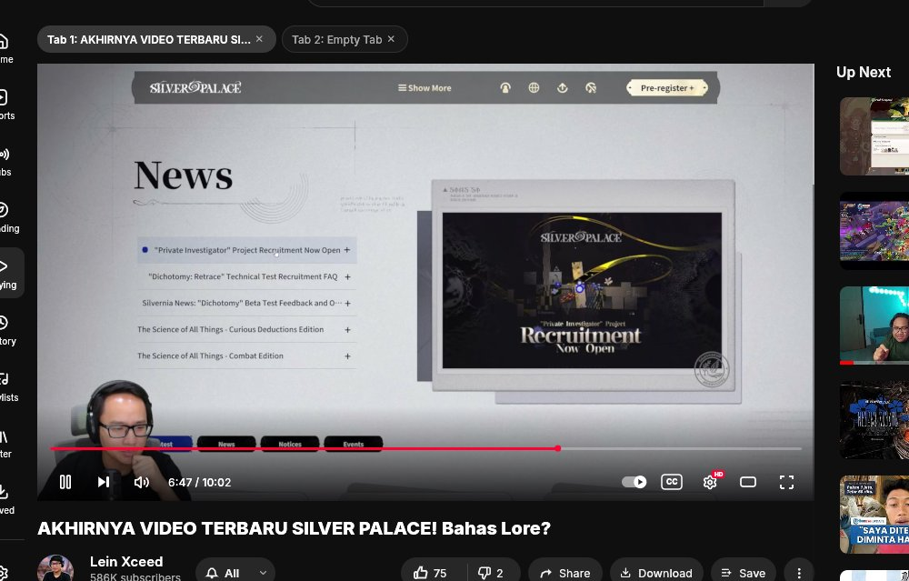
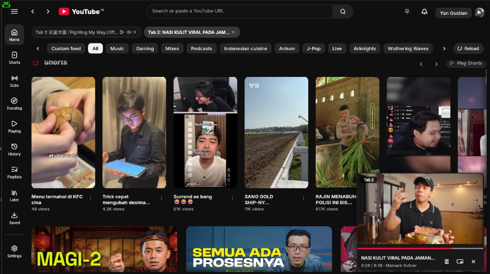
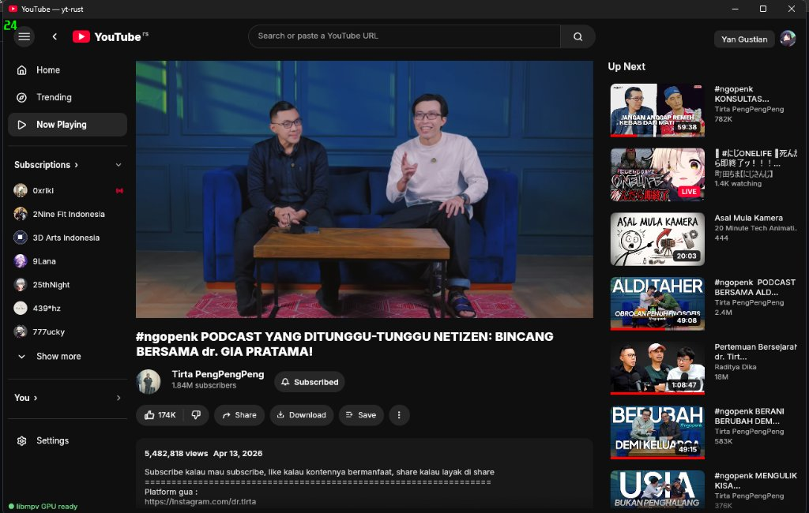
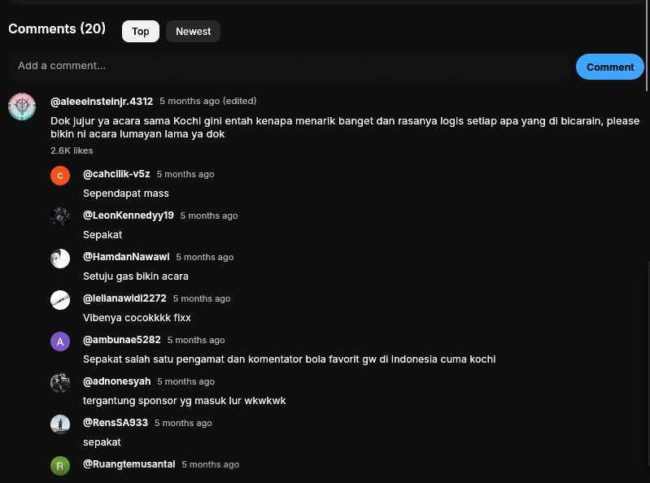
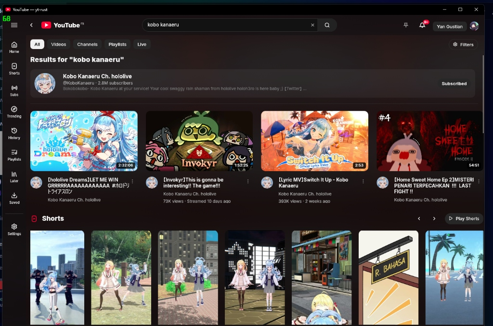
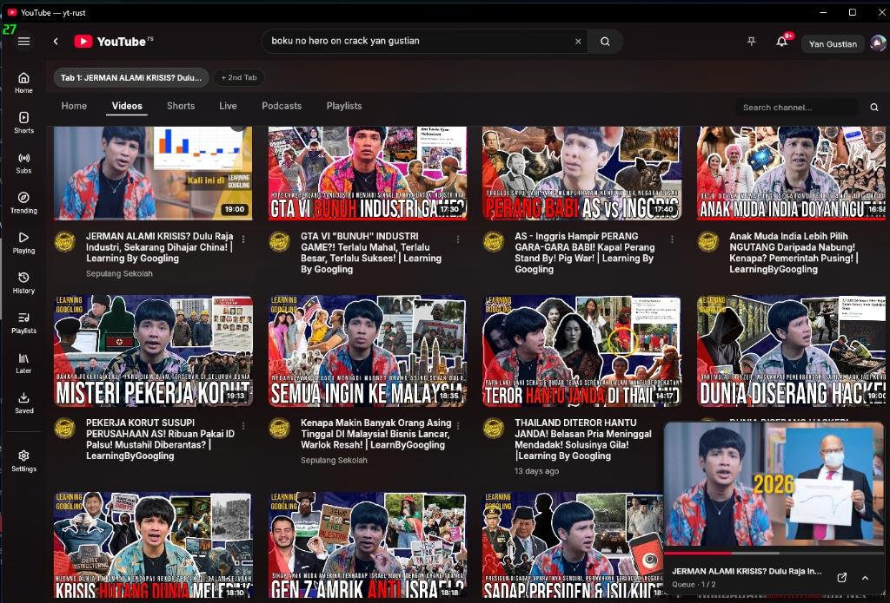
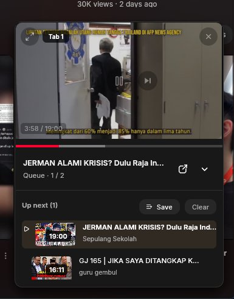
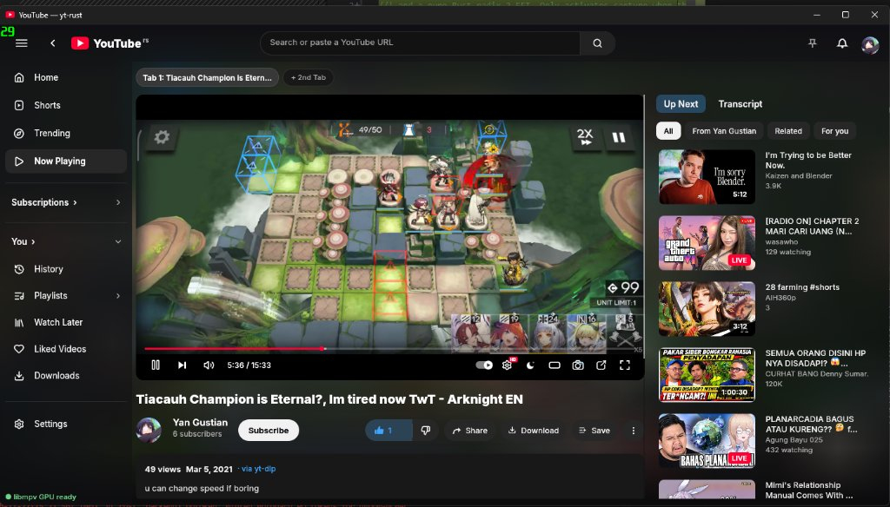
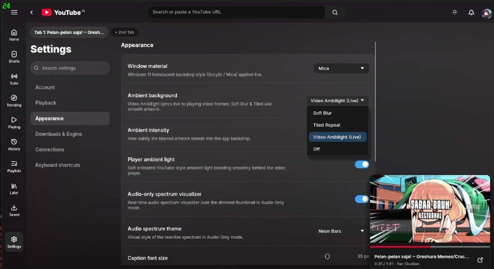
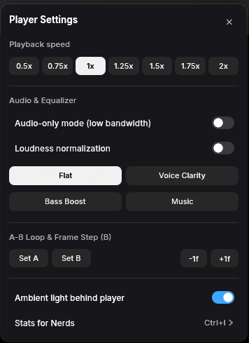

<div align="center">

# yt-rust

**A fast, lightweight native Windows desktop YouTube client built in Rust**  
Powered by [`eframe`](https://crates.io/crates/eframe) / [`egui`](https://crates.io/crates/egui) OpenGL, hardware-accelerated [`libmpv`](https://mpv.io/), and Windows-native shell & DWM integration.

[](https://www.rust-lang.org/)
[](https://github.com)
[](https://crates.io/crates/egui)
[](https://mpv.io/)

</div>

---

## Screenshots

| 2-Tab Watch Player & Controls | Vertical YouTube Shorts Reel | Home Feed, 2 Tabs & In-App PiP |
| :---: | :---: | :---: |
|  |  |  |

| Expanded Sidebar & Subscriptions | Livestream & Interactive Live Chat | Comments Sort, Post & Replies |
| :---: | :---: | :---: |
|  |  |  |

| Search Filters, Channels & Shorts Shelf | Sticky Channel Tabs & Video Grid | Mini-Player Hover Controls & Queue |
| :---: | :---: | :---: |
|  |  |  |

| Live Video Ambilight & Drag Pills | Appearance, Spectrum & Floating PiP | Player Settings Popover |
| :---: | :---: | :---: |
|  |  |  |

---

## Key Features

### Dual-Tab Player, Mini-Player & Smart Playback
- **Two Concurrent Player Tabs**: Open a second video directly in **Tab 2**, control play/pause or mute from the tab strip while browsing, and swap instantly between tabs without losing state.
- **2-Tab Session Resume**: Crash-safe persistence (`last_watch.json`) restores both active and background tabs at their exact timestamps on startup or via clickable Home **Continue watching** cards.
- **YouTube-Style In-App Mini-Player & Queue**: Corner-snapping PiP with on-hover overlay controls (Expand, Close `X`, Play/Pause, Next, timestamp pill), seekbar scrubbing, Windows PiP pop-out, and an expandable **Up next** Queue drawer that auto-lifts when opened and snaps back down when closed.
- **Hover Video Preview**: Muted auto-playing card previews on Home, Channel, Subscriptions, and Search grids (configurable quality or Off, with mute toggle and automatic idle GPU teardown).
- **Native 1080p–4K OpenGL Playback (`libmpv`)**: Automatic first-run `libmpv-2.dll` downloader (`shinchiro/mpv-winbuild-cmake`), selectable hardware decoding (`auto-copy` GPU / software fallback), codec/resolution picker (`H.264`, `VP9`, `AV1`), multi-audio track selection, playback speed (`0.5x–2.0x`), closed captions (`.vtt`) + secondary subtitle lane, chapters, storyboard seekbar previews, A-B loop & frame stepping, loudnorm + Equalizer (`Flat`, `Voice Clarity`, `Bass Boost`, `Music`), automatic Windows audio output device switching (`IMMNotificationClient` + `ao-reload`), **Stats for Nerds** (`Ctrl+I`), and GL-thread FBO/texture cleanup with paused-frame render skipping.
- **Audio-Only Mode & Live Spectrum Visualizer (`src/audio_viz.rs`)**: Switch to audio-only playback over the deep-dimmed video thumbnail with a non-blocking top pill bar and an optional real-time WASAPI loopback FFT spectrum/wave visualizer (**Wave Bars**, **Horizon Wave**, **Aurora Wave**, **Neon Bars**, **Radial Ring**, **Retro LED**).
- **Parallel HTTP Range Prefetch Proxy (`src/proxy.rs`)**: Prevents single-connection throttling during 1080p+ and 4K adaptive streaming, with instant latest-seek cursor prioritization.
- **DVR Live Streams**: Pinned live-edge scrubber with `-MM:SS` rewind hover timestamps and clickable `● Live` resync badge.

### Shorts, Search Filters, Windows PiP & Sleep Timer
- **Polished YouTube Shorts Reel & Shelves**: Horizontal 9:16 **Shorts** shelves on Home and Search results, plus a center-locked rounded vertical **Shorts Reel** viewer (stays centered when opening Sidebar or Comments) with overlaid channel/subscribe header, aligned action rail, right-edge hover navigation arrows, smooth slide transitions with portrait thumbnail buffering preview, wheel debounce, single-pass quality selection, **Grid View**, Like/Dislike, Comments drawer, Share, and Save.
- **Full YouTube Search & Filters**: Filter tabs (`All`, `Videos`, `Channels`, `Playlists`, `Live`), multi-column Search **Filters** drawer (Upload date, Type, Duration, Sort by), channel & playlist cards, separated Search Shorts shelf, and left-aligned search history + live autocomplete suggestions.
- **Borderless Windows Floating PiP**: Pop any playing video out into a borderless, always-on-top Windows overlay showing only edge-to-edge video playback with hover-only minimal controls (drag anywhere to move, bottom-right resize handle, scroll wheel volume, double-click / `Esc` to restore).
- **Sleep Timer with Audio Fade-Out**: Segmented `HH : MM : SS` picker (`^`/`v` arrows, mouse wheel, vertical hold-drag scrubbing, and per-segment typing) plus presets (**Off**, **10 min**–**60 min**, **End of video**) and optional smooth final-10s volume fade-out before pausing.
- **On-Demand BotGuard PO Token (`src/potoken.rs`)**: Hidden WebView2 (`tao` + `wry`) PO Token minter with **Auto (When blocked)** / **Always On** / **Off** modes — spawns on demand with 0 MB idle overhead when normal clients succeed, and automatically injects `--extractor-args` PO tokens when `yt-dlp` fallback encounters bot checks or `403`.

### Native Desktop Polish & Themes
- **Windows 11 Window Materials (`DwmSetWindowAttribute`)**: Live-switchable **Solid Dark**, **Acrylic**, **Mica**, and **Mica Alt** translucent surfaces across the shell without restarting.
- **Live Video Ambilight & Ambient Backdrop**: Choose **Video Ambilight (Live)** (real-time GPU frame-sampled perimeter glow & backdrop synced to playing video frames), **Soft Blur**, **Tiled Repeat**, or **Off** with adjustable intensity (`5%–70%`) and optional smooth glow around the player.
- **Redesigned Searchable Settings**: Categorized sidebar (`Account`, `Playback`, `Appearance`, `Downloads & Engine`, `Connections`, `Keyboard shortcuts`) with instant global **and per-group** search filtering.
- **OS & Hardware Integration**: Windows SMTC media flyout & hardware media keys (`src/os_media.rs`), Windows System Tray (`Close`/`Minimize to tray`), Taskbar thumbnail transport controls (`ITaskbarList3`), customizable global/player shortcuts, and mouse `XButton1` / `XButton2` navigation.

### Google Account, Comments, Live Chat & Downloads
- **Embedded WebView2 Sign-In**: Secure Google authentication stored in Windows Credential Manager (`keyring`) with automatic cookie rotation.
- **Synced Library & Feeds**: Two-way Watch History (`FEhistory` + `videostats`), personalized Home topic chips & YouTube Mix radio cards, Subscriptions filters (`All` / `Unwatched` / `Live`), Trending, Playlists, **Save to Playlist** modal, Channel pages (`Home` / `Videos` / `Shorts` / `Live` / `Podcasts` / `Playlists`, `Latest` / `Popular` / `Oldest` sort chips, sticky full-width tab bar, `Play All` / `Shuffle`, and in-channel search), thumbnail `Members only` badges, drag-to-scroll pill bars, and bell notifications (`All` / `Live` / `Videos` filters + right-click video context menu).
- **Interactive Engagement & Queue**: Top/Newest comments with expandable replies, clickable `MM:SS` / `H:MM:SS` timestamps across descriptions/comments/replies, comment posting, live & replay **Live Chat** polling/sending with emotes, persistent drag-reorderable Play Queue, and **Save Queue as Playlist**.
- **Community Integrations & Offline Downloads**: Optional **SponsorBlock** auto-skip per category, **DeArrow** title/thumbnail replacement, **Return YouTube Dislike** counts, and a built-in `yt-dlp` Downloads manager with live progress and offline playback.

---

## Project Architecture

| Module | Purpose |
| :--- | :--- |
| `src/main.rs` | Application entry point, `--login` / `--potoken` subprocess dispatch, `eframe` OpenGL (`Glow`) & transparent backdrop setup, crash diagnostics |
| `src/ui/` | Modular UI (`mod.rs`, `topbar.rs`, `sidebar.rs`, `cards.rs`, `pages.rs`, `watch.rs`) covering pages, dual tabs, Windows PiP, Sleep Timer, and Settings |
| `src/innertube.rs` | InnerTube API client and parsers for feeds, watch/HLS, Shorts, channels, playlists, comments, live chat, captions, and notifications |
| `src/backend.rs` | Async Tokio worker managing API requests, PO Token lifecycle, blurred ambient art generation, avatar/thumb disk cache, and watchtime reporting |
| `src/potoken.rs` | On-demand BotGuard PO Token minter in an isolated hidden WebView2 (`tao` + `wry`) child process |
| `src/mpv.rs` | Dynamic `libmpv-2.dll` loader, dual/tabbed OpenGL FBO renderers, GPU Video Ambilight sampling, and auto-downloader |
| `src/audio_viz.rs` | Windows WASAPI loopback audio capture and pure-Rust FFT spectrum/wave analyzer for Audio-Only mode |
| `src/proxy.rs` | Multi-worker localhost HTTP byte-range prefetch proxy for smooth 1080p–4K playback |
| `src/ytdlp.rs` | `yt-dlp` fallback resolver with PO Token extractor args and offline media downloader |
| `src/win_shell.rs` | Windows Tray icon, Taskbar `ITaskbarList3` preview buttons, `IMMNotificationClient` audio output watcher, and DWM Acrylic/Mica integration |
| `src/os_media.rs` | Windows SMTC media session & hardware media key handling (`souvlaki`) |
| `src/auth.rs` & `src/login.rs` | Embedded WebView2 Google OAuth cookie capture & `SAPISIDHASH` request signing |
| `src/sponsorblock.rs` | SponsorBlock segment skip, DeArrow branding, and Return YouTube Dislike lookups |
| `src/images.rs` | Pooled HTTP image loader, bounded GPU texture cache, and disk caching |
| `src/model.rs` & `src/theme.rs` | Data models, theme palette, translucent/acrylic surface helpers, bundled fonts, and crisp procedural/supersampled icons |
| `build.rs` | Windows `.rc` icon resource & SegmentHeap manifest embedding (`winresource`) |

---

## Build & Run

### Requirements
- [Rust toolchain](https://rustup.rs/) (**Edition 2024**)
- **Windows WebView2 Runtime** (pre-installed on Windows 10/11 — used for Google sign-in and optional on-demand BotGuard PO Token minting)
- *Optional*: `ffmpeg` on `PATH` for muxing high-resolution video/audio downloads via `yt-dlp`

```bash
# Run all unit tests
cargo test --locked

# Build optimized release binary
cargo build --release

# Launch release binary
./target/release/yt-rust.exe
```

> **Tip:** If `libmpv-2.dll` is not yet installed, open **Settings › Downloads & Engine** in the app and click **Download libmpv-2.dll** (or place `libmpv-2.dll` beside `yt-rust.exe`).

---

## Contributing

Contributions are welcome! Whether improving InnerTube resilience, polishing UI/UX, or tackling items in [ROADMAP.md](ROADMAP.md):

1. Read [CONTRIBUTING.md](CONTRIBUTING.md) for architecture notes, code style, and PR guidelines.
2. Create a topic branch (`feat/...`, `fix/...`, `docs/...`).
3. Make sure `cargo test --locked` and `cargo check --all-targets` pass cleanly before opening a Pull Request.

## Bundled Assets & Licenses

Fonts bundled under `assets/fonts/`:
- **Inter** (SIL Open Font License 1.1) — `assets/fonts/LICENSE-inter.txt`
- **Lucide** (ISC License) — `assets/fonts/LICENSE-lucide.txt`
