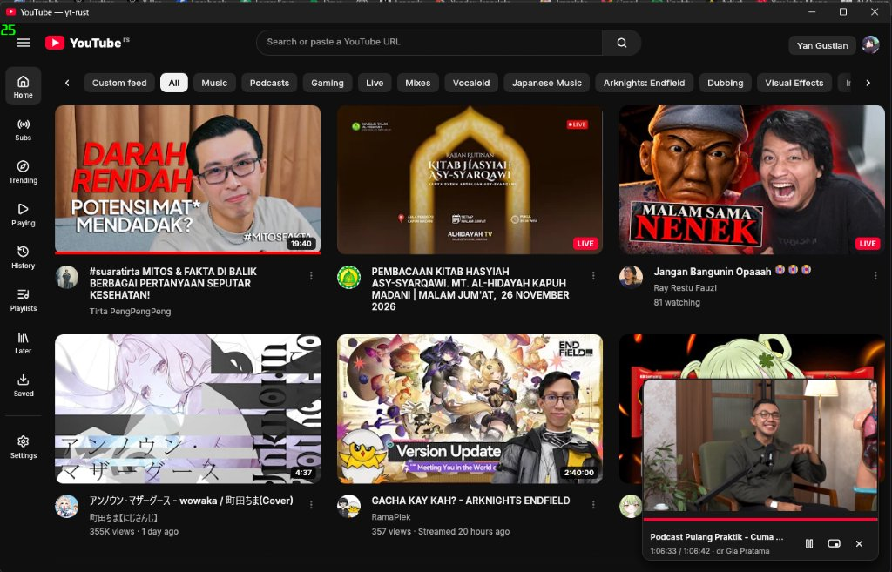
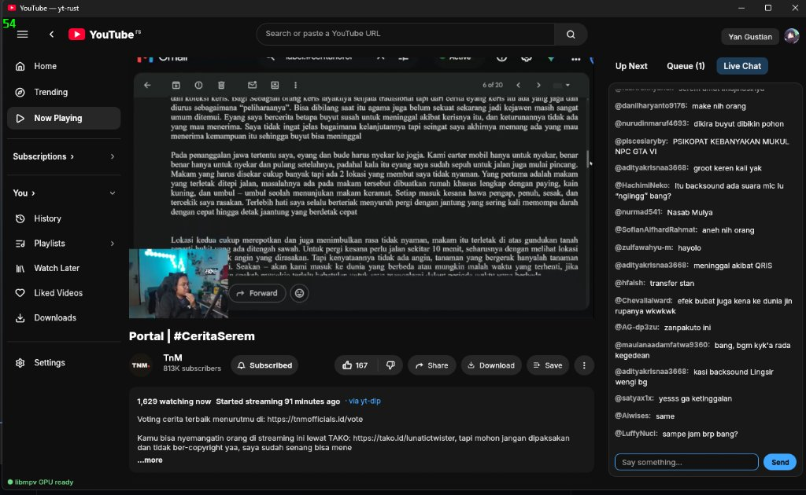

# yt-rust

A fast, lightweight native Windows desktop YouTube client written in Rust with [`eframe`](https://crates.io/crates/eframe) / [`egui`](https://crates.io/crates/egui) and OpenGL [`libmpv`](https://mpv.io/).

## Screenshots

| Home Feed + Floating PiP | Watch Player & Up Next | Expanded Sidebar & Subscriptions |
| :---: | :---: | :---: |
|  |  |  |

| Livestream & Interactive Live Chat | Comments Sort, Post & Replies |
| :---: | :---: |
|  |  |

## Features

- **Native 1080p–4K Playback (`libmpv` + OpenGL FBO) & OS Media Integration**
  - Auto-downloads `libmpv-2.dll` on Windows (`shinchiro/mpv-winbuild-cmake`) on first setup via Settings.
  - Built-in localhost parallel HTTP range prefetch proxy (`src/proxy.rs`) to prevent single-stream throttling/buffering at 1080p+.
  - Selectable resolution & codec (`H.264`, `VP9`, `AV1`), multi-audio track selector (*Original* / auto-dubbed), speed control (`0.5x–2.0x`), closed captions (`.vtt`), chapters, storyboard seekbar thumbnail previews, **Stats for Nerds** (`Ctrl+I`), and auto-hiding player controls.
  - YouTube-style **Live** edge bar (pinned right at live edge with `-MM:SS` DVR rewind hover preview and clickable `● Live` jump-to-live badge).
  - **Windows SMTC & Hardware Media Keys** (`src/os_media.rs`) via `souvlaki`: Windows media flyout shows title, channel, cover thumbnail, timeline progress, and responds to Play/Pause, Next, Previous, and Seek.
- **Google Account & Sync**
  - Embedded WebView2 Google sign-in (`tao` + `wry`) with session credentials stored in the OS keychain (`keyring`).
  - Two-way Watch History sync (`FEhistory` + YouTube `videostats` watchtime reporting) with resume progress bars (`startPercent` / `startTimeSeconds`), automatic resume on playback, and **Remove from Watch History** support.
  - Personalized Home feed + filter chips bar (horizontal wheel, `<` / `>` buttons, and left-click drag panning), **Subscriptions** filtering (`All` / `Unwatched` / `Live now`), Trending, Liked Videos (`VLLL`), and Watch Later (`VLWL`).
- **Channel Pages, Playlists & Queue**
  - Full Channel pages with banner, avatar, subscriber count, subscribe toggle, and `Videos` / `Shorts` / `Live` / `Playlists` tabs.
  - Library **Playlists** view & interactive **Save to Playlist** modal with playlist search filter, playlist thumbnails, existing playlist membership checkmarks, Watch Later sync, and playlist creation.
  - Persistent Play Queue (`Up Next` / `Queue` / `Live Chat`) with hold-and-drag reordering, **Save Queue as Playlist**, crash-safe Last-Watched + Queue resume, rounded corner-snapping floating PiP mini-player, mouse Back/Forward navigation (`XButton1` / `XButton2`), and SponsorBlock auto-skip.
- **Interactive Comments, Live Chat & Offline Downloads**
  - Live YouTube search autocomplete suggestions and direct URL/video-ID paste.
  - Interactive Comments: **Top / Newest** sort chips, expandable comment replies (`commentRepliesRenderer`), pagination, and **Add a comment** posting (`comment/create_comment`).
  - Interactive **Live Chat** polling with signed-in message sending (`live_chat/send_message`) and Like/Dislike sync.
  - Built-in **Downloads** manager page tracking live `yt-dlp` download progress (`%`, speed, size), configurable output folder, offline playback in `libmpv`, and optional `yt-dlp` fallback (`node` / QuickJS `qjs` runtime auto-resolved).

## Project Structure

- `src/main.rs` — App entry point, `eframe` OpenGL (`Glow`) setup, image/texture loaders, Windows crash/panic logger
- `src/ui/` — Modular application UI (`mod.rs`, `topbar.rs`, `sidebar.rs`, `cards.rs`, `pages.rs`, `watch.rs`)
- `src/os_media.rs` — Windows SMTC media flyout & hardware media-key integration (`souvlaki`)
- `src/images.rs` — Pooled `reqwest` HTTP image `BytesLoader`, disk thumbnail cache, and bounded GPU `TextureLoader`
- `src/innertube.rs` — Direct InnerTube API client, feed/channel/watch/playlist/caption/comments/live-chat/storyboard parsers
- `src/backend.rs` — Async Tokio backend worker & watchtime history sync loop
- `src/mpv.rs` — Dynamic `libmpv-2.dll` bindings & OpenGL FBO rendering
- `src/proxy.rs` — Localhost multi-worker HTTP range prefetch proxy
- `src/auth.rs` & `src/login.rs` — WebView2 Google login & `SAPISIDHASH` request signing
- `src/sponsorblock.rs` — SponsorBlock segment lookup
- `src/ytdlp.rs` — `yt-dlp` fallback resolver & streaming progress offline downloader
- `src/model.rs` & `src/theme.rs` — Data models, YouTube dark palette, custom vector icons, bundled fonts & app icon
- `build.rs` — Windows resource & SegmentHeap manifest embedding via `winresource`
- `.github/workflows/ci.yml` — GitHub Actions CI (`cargo test --locked` & Windows release packaging)

## Contributing

Contributions are very welcome! **yt-rust** is open for contributors — whether fixing bugs, improving InnerTube compatibility, polishing UI details, or picking up remaining items in [ROADMAP.md](ROADMAP.md).

### How to Contribute
1. Read [CONTRIBUTING.md](CONTRIBUTING.md) for architecture notes, UI conventions, and PR guidelines.
2. Check [ROADMAP.md](ROADMAP.md) (see **Phase 5–7**) or existing issues/PRs to pick up planned work.
3. Fork the repository and create a topic branch (`feat/...`, `fix/...`, `docs/...`).
4. Ensure `cargo test --locked` passes with zero compiler warnings before opening a Pull Request.

## Build & Run

Requirements:
- [Rust toolchain](https://rustup.rs/) (edition 2024)
- Windows WebView2 Runtime (built-in on Windows 10/11, for Google sign-in)
- Optional: `ffmpeg` on `PATH` for merging video/audio downloads via `yt-dlp`

```bash
# Run unit tests
cargo test

# Build optimized release binary
cargo build --release

# Run release binary
./target/release/yt-rust.exe
```

If `libmpv-2.dll` is not yet installed, open **Settings** in the app and click **Download libmpv-2.dll automatically** (or place `libmpv-2.dll` next to `yt-rust.exe`).

## Bundled Assets & Licenses

Fonts bundled under `assets/fonts/`:
- **Inter** (SIL Open Font License 1.1) — `assets/fonts/LICENSE-inter.txt`
- **Lucide** (ISC License) — `assets/fonts/LICENSE-lucide.txt`
