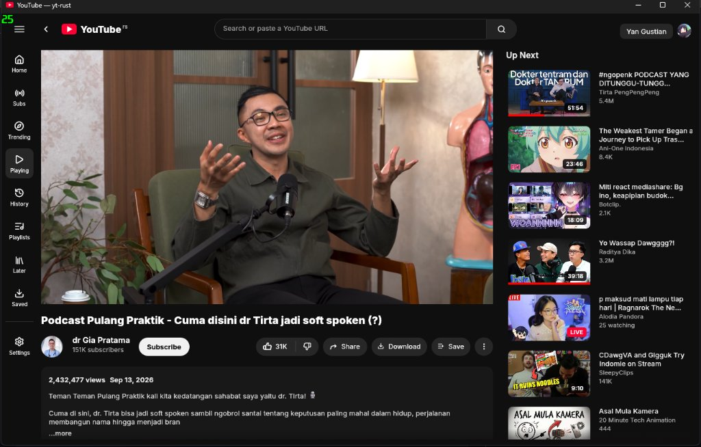

# yt-rust

A fast, lightweight native Windows desktop YouTube client written in Rust with [`eframe`](https://crates.io/crates/eframe) / [`egui`](https://crates.io/crates/egui) and OpenGL [`libmpv`](https://mpv.io/).

## Screenshots

| Home Feed + Floating PiP | Watch Player & Up Next | Expanded Sidebar & Subscriptions |
| :---: | :---: | :---: |
|  |  |  |

## Features

- **Native 1080p–4K Playback (`libmpv` + OpenGL FBO)**
  - Auto-downloads `libmpv-2.dll` on Windows (`shinchiro/mpv-winbuild-cmake`) on first setup via Settings.
  - Built-in localhost parallel HTTP range prefetch proxy (`src/proxy.rs`) to prevent single-stream throttling/buffering at 1080p+.
  - Selectable resolution & codec (`H.264`, `VP9`, `AV1`), multi-audio track selector (*Original* / auto-dubbed), speed control (`0.5x–2.0x`), closed captions (`.vtt`), chapters, and storyboard seekbar thumbnail previews.
- **Google Account & Sync**
  - Embedded WebView2 Google sign-in (`tao` + `wry`) with session credentials stored in the OS keychain (`keyring`).
  - Two-way Watch History sync (`FEhistory` + YouTube `videostats` watchtime reporting) with resume progress bars (`startPercent` / `startTimeSeconds`) and automatic resume on playback.
  - Personalized Home feed + filter chips bar (horizontal wheel, `<` / `>` buttons, and left-click drag panning), Subscriptions feed & channel list, Trending, Liked Videos (`VLLL`), and Watch Later (`VLWL`).
- **Channel Pages, Playlists & Queue**
  - Full Channel pages with banner, avatar, subscriber count, subscribe toggle, and `Videos` / `Shorts` / `Live` / `Playlists` tabs.
  - Library **Playlists** view & interactive **Save to Playlist** modal with playlist search filter, playlist thumbnails, existing playlist membership checkmarks, Watch Later sync, and playlist creation.
  - Persistent Play Queue (`Up Next` / `Queue` / `Live Chat`) with drag-to-reorder, crash-safe Last-Watched + Queue resume, auto-PiP on scroll with corner-snapping mini-player, mouse Back/Forward navigation (`XButton1` / `XButton2`), and SponsorBlock auto-skip.
- **Search, Comments & Offline Downloads**
  - Live YouTube search autocomplete suggestions, direct URL/video-ID paste, comments pagination, live chat polling, Like/Dislike, and optional `yt-dlp` stream fallback / MP4 & M4A downloads (configurable folder in Settings).

## Project Structure

- `src/main.rs` — App entry point, `eframe` OpenGL (`Glow`) setup, image/texture loaders, Windows crash/panic logger
- `src/ui/` — Modular application UI (`mod.rs`, `topbar.rs`, `sidebar.rs`, `cards.rs`, `pages.rs`, `watch.rs`)
- `src/images.rs` — Pooled `reqwest` HTTP image `BytesLoader`, disk thumbnail cache, and bounded GPU `TextureLoader`
- `src/innertube.rs` — Direct InnerTube API client, feed/channel/watch/playlist/caption/storyboard parsers
- `src/backend.rs` — Async Tokio backend worker & watchtime history sync loop
- `src/mpv.rs` — Dynamic `libmpv-2.dll` bindings & OpenGL FBO rendering
- `src/proxy.rs` — Localhost multi-worker HTTP range prefetch proxy
- `src/auth.rs` & `src/login.rs` — WebView2 Google login & `SAPISIDHASH` request signing
- `src/sponsorblock.rs` — SponsorBlock segment lookup
- `src/ytdlp.rs` — `yt-dlp` fallback resolver & offline downloader
- `src/model.rs` & `src/theme.rs` — Data models, YouTube dark palette, custom vector icons, bundled fonts & app icon
- `build.rs` — Windows resource & SegmentHeap manifest embedding via `winresource`

## Build & Run

Requirements:
- [Rust toolchain](https://rustup.rs/) (edition 2024)
- Windows WebView2 Runtime (built-in on Windows 10/11, for Google sign-in)
- Optional: `ffmpeg` on `PATH` for merging video/audio downloads via `yt-dlp`

```bash
# Run unit tests
cargo test

# Build optimized release binary
cargo build --release

# Run release binary
./target/release/yt-rust.exe
```

If `libmpv-2.dll` is not yet installed, open **Settings** in the app and click **Download libmpv-2.dll automatically** (or place `libmpv-2.dll` next to `yt-rust.exe`).

## Bundled Assets & Licenses

Fonts bundled under `assets/fonts/`:
- **Inter** (SIL Open Font License 1.1) — `assets/fonts/LICENSE-inter.txt`
- **Lucide** (ISC License) — `assets/fonts/LICENSE-lucide.txt`
